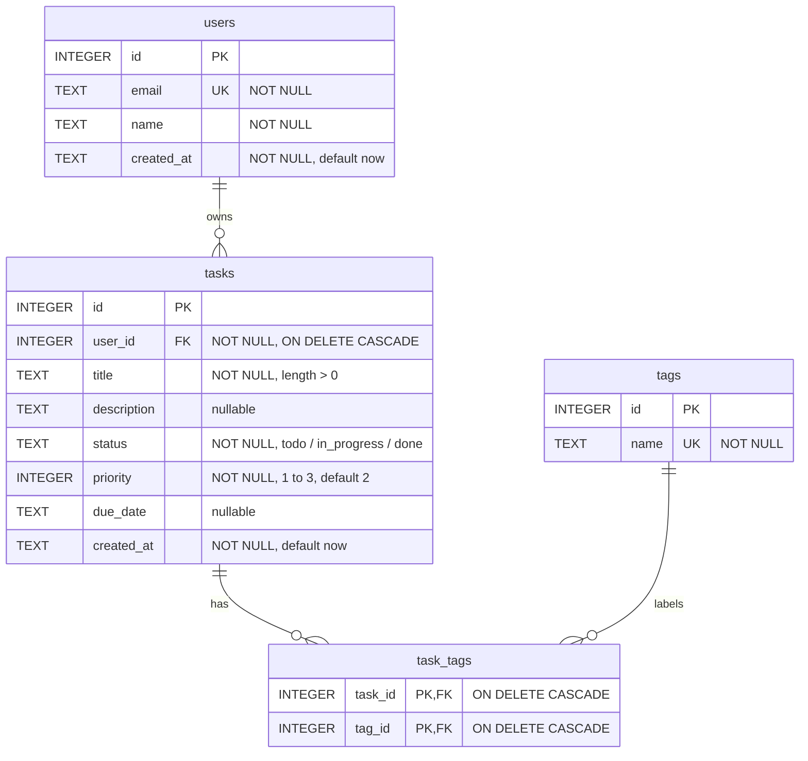

# M06 — SQL Fundamentals with SQLite: Training Material

**Week 3 · Days 1-2 · 6 hours**

A "module" in this program means a training stage. When this guide says "ES module" it means a JavaScript
module file. The guide's own steps are called "stages" too, so "the stage" means this module and "Stage 4"
means a step of the guided path below.

## Builds on

M05 (Express Task API v1). Its in-memory task store gets a real relational schema here, and M07 puts Prisma
on top of that schema. Keep your schema and your ERD: you will translate them in M07.

## 1. What you'll build and why

You will design a small relational schema and write the SQL to query it by hand, before an ORM hides it.
You finish with:

- a **`users` / `tasks` / `tags` / `task_tags` schema**, created and seeded with SQL files,
- **20 or more query exercises that you write yourself and run**, covering filtering, sorting and
  pagination, `INNER` and `LEFT` joins, aggregates with `GROUP BY` and `HAVING`, and at least one subquery,
- **at least one query inside an explicit transaction** (`BEGIN` / `COMMIT` / `ROLLBACK`),
- a **working SQL injection demo and its fix**: a vulnerable, string-concatenated query that you really
  attack, and the same query with parameters that really blocks the attack,
- a **Mermaid ERD in a README** that matches the schema you actually built.

Why this stage matters: in M07 an ORM generates SQL for you. If you have never written a join, a
constraint, an index or a transaction by hand, the ORM is a black box and you cannot tell when it is doing
something slow or wrong. The injection demo shows the one mistake an ORM mostly protects you from, so that
you can recognise it when you drop to raw SQL.

SQLite is the only database you touch hands-on in this program. PostgreSQL and MongoDB come up as concepts
only.

### What the exercises are, and are not

There is no shared exercise bank. **You write your own 20 or more exercises against your own schema.** A
trainer checks coverage and correctness at the checkpoint by picking a few at random and asking you to run
and explain them, so write only queries you understand.

This guide shows a **reference set of 25 exercises** (Stages 5 to 10) so you can see the level, and the
reference schema and seed data they run against. Try each group yourself first, then compare. If you copy
the reference set without understanding it, you will not be able to explain it at the checkpoint.

### Where the code goes

All code lives in your build repo, in a standalone stage folder (not in the Task API project):

```text
modules/m06-sql-fundamentals-sqlite/
├── README.md              the Mermaid ERD
├── schema.sql, seed.sql
├── exercises/             20+ graded queries
└── injection-demo/        the vulnerable query, the attack, and the fix
```

### How to use this guide

- Work the stages in order. Each one ends in a **Done when** checklist you can verify yourself.
- Commands and output are from a reference build on macOS with Node 24 and the `sqlite3` CLI 3.51.0. Your
  wording may differ slightly, but the results should match.
- A line starting with `$` is typed in a terminal. Everything else is file content or output.

## 2. Before you start

You need:

- **Node.js 24 LTS.** The program pins one version in `.nvmrc`. Run `nvm use` in your build repo's root.
  This stage only needs Node for the injection demo.
- **The `sqlite3` command line tool**, or DB Browser for SQLite (both free, either is fine). This guide uses
  the command line tool. Check it with `sqlite3 --version`. macOS ships with it. If you use DB Browser
  instead, run each `.sql` file through its "Execute SQL" tab and read the results there. The dot-commands
  (lines that start with `.`, such as `.headers on`) belong to the command line tool only.
- **A build repo with a feature branch habit**: a branch named `feat/module-06/<topic>`, Conventional
  Commits, and a pull request. You do not push to `main`.
- **Your M05 work on hand.** The Task API's `tasks` have `id`, `title`, an optional `description` and a
  `status` of `todo`, `in_progress` or `done`. Your `tasks` table should carry those four fields.

Pinned versions that matter in this stage:

| Tool | Version |
| --- | --- |
| Node.js | 24 LTS |
| SQLite | the `sqlite3` CLI (3.x), and the copy bundled in `better-sqlite3` for the demo |
| TypeScript | 7.0 (the injection demo, as in M04 and M05) |
| `better-sqlite3` | 12.x (the SQLite driver; M07's Prisma adapter uses the same one) |

Free tools only. No Docker. No paid licences.

## 3. Guided path

### Stage 1 — Create the branch and the stage folder

**Goal:** start from an up-to-date `main` on a new branch, with the folder layout ready.

1. In your build repo, make sure your previous stage is merged, then:

   ```bash
   git switch main
   git pull
   git switch -c feat/module-06/sql-fundamentals-sqlite
   ```

   You branch from `main`, not from your M05 branch, so M06 does not sit on top of M05's history.

2. Make the folders:

   ```bash
   mkdir -p modules/m06-sql-fundamentals-sqlite/exercises modules/m06-sql-fundamentals-sqlite/injection-demo
   cd modules/m06-sql-fundamentals-sqlite
   ```

3. Check your tools:

   ```bash
   sqlite3 --version
   node --version
   ```

4. Make sure the database file and the demo's installed packages will never be committed. Your repo's
   `.gitignore` should contain `*.db` and `node_modules/`. Check them later, once the files exist, with
   `git check-ignore -v m06.db` and `git check-ignore -v injection-demo/node_modules`. Each should print the
   `.gitignore` line that matches.

**Done when:**

- [ ] `git branch --show-current` prints `feat/module-06/sql-fundamentals-sqlite`.
- [ ] `sqlite3 --version` prints a 3.x version, and `node --version` prints a 24.x version.
- [ ] The `exercises/` and `injection-demo/` folders exist.

### Stage 2 — Design the schema before you write any SQL

**Goal:** decide the tables, the keys and the relationships on paper (or in a comment), so that the DDL in
Stage 3 is a translation and not a guess.

The Task API has four things: users, tasks, tags and the link between tasks and tags. Ask two questions
about each pair, one from each side:

| Pair | One side asks | The other side asks | Answer |
| --- | --- | --- | --- |
| user and task | Can a user own many tasks? Yes | Can a task have many owners? No, one | **1:N**. The foreign key goes on `tasks` (`tasks.user_id`). |
| task and tag | Can a task have many tags? Yes | Can a tag be on many tasks? Yes | **M:N**. It needs a junction table. |

**Why M:N needs its own table.** A single `tag_id` column on `tasks` would allow one tag per task. A text
column such as `'backend,bug,urgent'` cannot be indexed or constrained, `LIKE '%bug%'` would also match a tag
called `debug`, and removing a single tag means rewriting the whole string. So the relationship becomes a
table of its own with **one row per (task, tag) pair**.

Write down, for each table, the columns and the keys:

- `users`: an `id` (primary key), an `email` (unique, required), a `name` (required), a `created_at`.
- `tasks`: an `id`, a `user_id` (foreign key to `users`, required), a `title` (required), an optional
  `description`, a `status` limited to the three allowed values with a default of `todo`, and whatever else
  your exercises will want to filter and sort by. The reference build adds `priority` (1 to 3), `due_date`
  and `created_at`.
- `tags`: an `id` and a unique `name`.
- `task_tags`: a `task_id` and a `tag_id`, each a foreign key, with the pair as the primary key.

Decide, for each foreign key, what should happen when the parent row is deleted. The reference build
uses `ON DELETE CASCADE` everywhere, so removing a user removes their tasks, and removing a task or a tag
removes only the link rows. Write down one sentence on why for each one.

**Done when:**

- [ ] You have a list of the four tables with their columns, primary keys and foreign keys written down.
- [ ] You can explain, unaided, why the task-and-tag relationship needs a junction table and the
      user-and-task relationship does not. (Requirement: *model 1:N vs M:N*.)
- [ ] You can explain the difference between a primary key and a foreign key.

### Stage 3 — Write `schema.sql`

**Goal:** the DDL for all four tables, with constraints, foreign keys and indexes, in a file you can re-run.

Create `schema.sql`:

```sql
-- Module 6 output: the Task API schema, users / tasks / tags / task_tags.
-- Run it: sqlite3 m06.db < schema.sql
-- Success: `.tables` lists four tables, and re-running the file does not fail.
-- Re-running it DROPS all four tables and their data. Load seed.sql again afterwards: seed.sql is not
-- safe to run twice on its own, because its explicit ids would collide.

-- SQLite does not enforce foreign keys unless this is on, and it is per connection, not stored in
-- the database file. Every connection that writes must run it (the sqlite3 CLI and better-sqlite3
-- included).
PRAGMA foreign_keys = ON;

-- Drop children before parents, so the foreign keys never point at a table that is already gone.
DROP TABLE IF EXISTS task_tags;
DROP TABLE IF EXISTS tags;
DROP TABLE IF EXISTS tasks;
DROP TABLE IF EXISTS users;

CREATE TABLE users (
  id         INTEGER PRIMARY KEY,
  email      TEXT    NOT NULL UNIQUE,
  name       TEXT    NOT NULL,
  created_at TEXT    NOT NULL DEFAULT (datetime('now'))
);

-- 1:N with users: one user owns many tasks, and each task has exactly one owner.
-- id, title, description and status are the fields M05's API contract already fixes.
CREATE TABLE tasks (
  id          INTEGER PRIMARY KEY,
  user_id     INTEGER NOT NULL REFERENCES users (id) ON DELETE CASCADE,
  title       TEXT    NOT NULL CHECK (length(title) > 0),
  description TEXT,
  status      TEXT    NOT NULL DEFAULT 'todo' CHECK (status IN ('todo', 'in_progress', 'done')),
  priority    INTEGER NOT NULL DEFAULT 2 CHECK (priority BETWEEN 1 AND 3),
  due_date    TEXT,
  created_at  TEXT    NOT NULL DEFAULT (datetime('now'))
);

CREATE TABLE tags (
  id   INTEGER PRIMARY KEY,
  name TEXT    NOT NULL UNIQUE
);

-- The junction table for M:N between tasks and tags. One row means "this task has this tag".
-- The pair (task_id, tag_id) is the primary key, so the same tag cannot be attached to the same
-- task twice and no surrogate id is needed. Deleting either side removes the link rows.
CREATE TABLE task_tags (
  task_id INTEGER NOT NULL REFERENCES tasks (id) ON DELETE CASCADE,
  tag_id  INTEGER NOT NULL REFERENCES tags (id)  ON DELETE CASCADE,
  PRIMARY KEY (task_id, tag_id)
);

-- Indexes. SQLite indexes the primary key but not foreign key columns, so index the ones the
-- queries filter or join on. Exercises 24 and 25 (in exercises/05-...) show the plan before and
-- after.
CREATE INDEX idx_tasks_user_id ON tasks (user_id);
CREATE INDEX idx_tasks_status  ON tasks (status);
CREATE INDEX idx_task_tags_tag_id ON task_tags (tag_id);
```

Why each part is there:

- **`PRAGMA foreign_keys = ON`** first. SQLite does **not** enforce foreign keys unless this is on, and it
  applies to one connection only, not to the file. Every connection that writes needs it. You will prove
  this in a moment.
- **`DROP TABLE IF EXISTS`, children first.** It makes the file re-runnable: run it any time to start
  from an empty schema. Running it again **deletes all rows**, so load `seed.sql` again afterwards. Children go first so a foreign key never points at a table that is already gone.
- **`INTEGER PRIMARY KEY`** makes the column an alias for SQLite's row id, so it numbers itself.
- **`CHECK`, `NOT NULL`, `UNIQUE`, `DEFAULT`** keep bad data out. SQLite's column types are a preference,
  not a rule (see the experiment below), so these constraints are what actually protect you.
- **The composite primary key on `task_tags`** is the pair. It stops the same tag being attached to the same
  task twice, and it means the table needs no `id` column: nothing refers to a single link row.
- **Indexes.** SQLite indexes the primary key but not foreign key columns. `idx_tasks_user_id` and
  `idx_task_tags_tag_id` cover the foreign keys you will join on, and `idx_tasks_status` covers the most
  common list filter. The primary key `(task_id, tag_id)` is already an index that serves lookups by
  `task_id`, so it needs no separate index.

Build the database and look at it:

```bash
rm -f m06.db
sqlite3 m06.db < schema.sql
sqlite3 m06.db < schema.sql   # run it twice: the DROP lines make this safe, but each run wipes all data
sqlite3 m06.db ".tables"
```

```text
tags       task_tags  tasks      users
```

#### Experiment: provoke every constraint

A constraint you have never seen fail is a constraint you do not trust. Run these one at a time (the
`PRAGMA` line is needed on each command, because each `sqlite3 m06.db "..."` call is a new connection):

```bash
sqlite3 m06.db "PRAGMA foreign_keys = ON; INSERT INTO users (email, name) VALUES ('a@example.com','Ada');"
sqlite3 m06.db "PRAGMA foreign_keys = ON; INSERT INTO users (email, name) VALUES ('a@example.com','Dup');"
sqlite3 m06.db "PRAGMA foreign_keys = ON; INSERT INTO users (email) VALUES ('b@example.com');"
sqlite3 m06.db "PRAGMA foreign_keys = ON; INSERT INTO tasks (user_id, title, status) VALUES (1,'x','blocked');"
sqlite3 m06.db "PRAGMA foreign_keys = ON; INSERT INTO tasks (user_id, title, priority) VALUES (1,'x',9);"
sqlite3 m06.db "PRAGMA foreign_keys = ON; INSERT INTO tasks (user_id, title) VALUES (1,'');"
sqlite3 m06.db "PRAGMA foreign_keys = ON; INSERT INTO tasks (user_id, title) VALUES (999,'orphan');"
```

The first succeeds. The rest should each fail, with these messages in the reference build:

```text
Error: stepping, UNIQUE constraint failed: users.email (19)
Error: stepping, NOT NULL constraint failed: users.name (19)
Error: stepping, CHECK constraint failed: status IN ('todo', 'in_progress', 'done') (19)
Error: stepping, CHECK constraint failed: priority BETWEEN 1 AND 3 (19)
Error: stepping, CHECK constraint failed: length(title) > 0 (19)
Error: stepping, FOREIGN KEY constraint failed (19)
```

Now the experiment that matters most. Run the orphan insert again **without** the pragma:

```bash
sqlite3 m06.db "INSERT INTO tasks (user_id, title) VALUES (999,'orphan'); SELECT id, user_id, title FROM tasks;"
```

```text
1|999|orphan
```

It succeeded. There is now a task whose owner does not exist. Foreign keys were not being enforced on that
connection. Clean up (`rm -f m06.db`, then re-run `schema.sql`), and remember that `PRAGMA foreign_keys = ON`
is something every connection must say.

One more, to see what "dynamic typing" means:

```bash
sqlite3 m06.db "CREATE TEMP TABLE t(n INTEGER); INSERT INTO t VALUES ('42'),('abc'); SELECT n, typeof(n) FROM t;"
```

```text
42|integer
abc|text
```

The column says `INTEGER`, yet it stored the text `abc` without complaint. The column type is an
*affinity*: SQLite tries to convert, and keeps the original if it cannot. That is why the `CHECK` constraints
carry the real rules here.

#### Optional: `ALTER` and `DROP`

You will rarely need these in this stage, but the stage covers them. Come back to this after Stage 4, with
`seed.sql` loaded, because the error in the second command below only appears when the table has rows. Try
them on a throwaway database (rebuild afterwards):

```bash
sqlite3 m06.db "ALTER TABLE tasks ADD COLUMN completed_at TEXT; SELECT name FROM pragma_table_info('tasks');"
sqlite3 m06.db "ALTER TABLE tasks ADD COLUMN reviewer TEXT NOT NULL;"
sqlite3 m06.db "ALTER TABLE tasks DROP COLUMN completed_at;"
```

In the reference build, on a seeded database, the first one added the column, the second failed with
`Cannot add a NOT NULL column with default value NULL` (existing rows would have nothing to put in it, so
you must give a `DEFAULT`), and the third removed it again. On an **empty** `tasks` table the second command
is accepted without any error, because there are no rows to fill, so do not read "no error" as "this is safe".
Run `rm -f m06.db` and rebuild from `schema.sql` and `seed.sql` afterwards, so the database matches your files
(an accepted `reviewer` column would otherwise stay).

**Done when:**

- [ ] `sqlite3 m06.db < schema.sql` runs twice in a row with no error, and `.tables` lists
      `tags`, `task_tags`, `tasks` and `users`.
- [ ] Each of the six bad inserts above fails with the matching error, and the orphan insert succeeds when
      the pragma is left off. (Requirement: *DDL, constraints, `PRAGMA foreign_keys`*.)
- [ ] `git check-ignore -v m06.db` prints the `.gitignore` rule that covers it.
- [ ] You can explain, in your own words, why every connection has to turn `foreign_keys` on, and what
      "type affinity" means.

### Stage 4 — Write `seed.sql`

**Goal:** data to query, shaped so each exercise has something to find.

Good seed data is not random. Decide in advance what your exercises will need, and put it in:

- a user who owns **no tasks** (to practise `LEFT JOIN` and `NOT EXISTS`),
- a tag that is on **no task**,
- some tasks with **no tags**,
- some tasks with a **`NULL` description or due date**,
- **repeated** statuses and priorities (for `GROUP BY`, and for ties in `ORDER BY`),
- enough rows that a filter returns some but not all of them.

Write the ids out explicitly instead of letting SQLite number them, so your exercises give the same answer on every run.

Create `seed.sql`:

```sql
-- Module 6 output: seed data for the Task API schema.
-- Run it after the schema: sqlite3 m06.db < schema.sql && sqlite3 m06.db < seed.sql
-- Success: users 5, tasks 24, tags 7, task_tags 37.
--
-- Ids are written out so the exercises give the same answer on every run. The data is shaped on
-- purpose so each exercise has something to find:
--   * user 5 (Esme) owns no tasks                -> LEFT JOIN, NOT EXISTS
--   * tag 7 (research) is on no task             -> LEFT JOIN from tags, HAVING
--   * tasks 6, 12, 19, 24 have no tags           -> LEFT JOIN from tasks
--   * several tasks have no description or no due date (NULL) -> IS NULL, COUNT(col) vs COUNT(*)
--   * priorities and statuses repeat             -> ties for ORDER BY, groups for GROUP BY

PRAGMA foreign_keys = ON;

INSERT INTO users (id, email, name, created_at) VALUES
  (1, 'ada@example.com',   'Ada Lovelace',  '2026-01-05 09:00:00'),
  (2, 'ben@example.com',   'Ben Carter',    '2026-01-12 10:30:00'),
  (3, 'chloe@example.com', 'Chloe Nguyen',  '2026-02-01 08:15:00'),
  (4, 'dev@example.com',   'Dev Patel',     '2026-02-20 14:45:00'),
  (5, 'esme@example.com',  'Esme Walker',   '2026-03-03 11:00:00');

INSERT INTO tags (id, name) VALUES
  (1, 'backend'),
  (2, 'frontend'),
  (3, 'bug'),
  (4, 'docs'),
  (5, 'urgent'),
  (6, 'chore'),
  (7, 'research');

INSERT INTO tasks (id, user_id, title, description, status, priority, due_date, created_at) VALUES
  (1,  1, 'Set up the Express project',      'Install Express 5 and TypeScript',  'done',        1, '2026-03-10', '2026-03-01 09:00:00'),
  (2,  1, 'Design the tasks table',          'Columns, types and constraints',    'done',        1, '2026-03-12', '2026-03-02 09:30:00'),
  (3,  1, 'Write the seed script',           NULL,                                'in_progress', 2, '2026-04-02', '2026-03-05 10:00:00'),
  (4,  1, 'Add pagination to the list',      'Keyset, not OFFSET',                'todo',        2, '2026-04-15', '2026-03-06 11:00:00'),
  (5,  1, 'Fix the duplicate email bug',     'UNIQUE is missing in staging',      'todo',        1, '2026-04-01', '2026-03-07 09:45:00'),
  (6,  1, 'Tidy the README',                 NULL,                                'todo',        3, NULL,         '2026-03-08 16:00:00'),
  (7,  2, 'Build the task list page',        'Table with a status filter',        'in_progress', 2, '2026-04-05', '2026-03-02 13:00:00'),
  (8,  2, 'Style the status badges',         NULL,                                'todo',        3, '2026-04-20', '2026-03-03 13:30:00'),
  (9,  2, 'Fix the broken date picker',      'Off by one on month ends',          'todo',        1, '2026-03-30', '2026-03-04 15:00:00'),
  (10, 2, 'Write the API usage docs',        'Examples for every endpoint',       'todo',        2, '2026-04-25', '2026-03-09 10:00:00'),
  (11, 2, 'Review the colour contrast',      'WCAG AA',                           'done',        2, '2026-03-20', '2026-03-10 10:30:00'),
  (12, 2, 'Archive the old branches',        NULL,                                'done',        3, NULL,         '2026-03-11 17:00:00'),
  (13, 3, 'Index the tasks table',           'user_id and status',                'in_progress', 1, '2026-04-03', '2026-03-12 09:00:00'),
  (14, 3, 'Document the junction table',     'Explain task_tags in the README',   'todo',        2, '2026-04-10', '2026-03-13 09:30:00'),
  (15, 3, 'Fix the slow list query',         'Full scan on status',               'in_progress', 1, '2026-04-04', '2026-03-14 11:15:00'),
  (16, 3, 'Compare SQLite and Postgres',     'Notes only, no code',               'todo',        3, NULL,         '2026-03-15 14:00:00'),
  (17, 3, 'Add a health check endpoint',     'GET /health',                       'done',        2, '2026-03-18', '2026-03-16 10:00:00'),
  (18, 3, 'Rotate the staging API key',      NULL,                                'todo',        2, '2026-04-08', '2026-03-17 12:00:00'),
  (19, 4, 'Clean up unused dependencies',    NULL,                                'done',        3, NULL,         '2026-03-18 09:00:00'),
  (20, 4, 'Fix the failing login test',      'Flaky on CI only',                  'todo',        1, '2026-03-31', '2026-03-19 09:30:00'),
  (21, 4, 'Write the migration guide',       'From in-memory to SQLite',          'in_progress', 2, '2026-04-12', '2026-03-20 10:00:00'),
  (22, 4, 'Prototype the tag filter',        'Filter tasks by tag name',          'todo',        2, '2026-04-18', '2026-03-21 10:30:00'),
  (23, 4, 'Update the contributing guide',   'Branch and commit rules',           'done',        3, '2026-03-25', '2026-03-22 15:30:00'),
  (24, 4, 'Remove the old config file',      NULL,                                'todo',        3, NULL,         '2026-03-23 16:30:00');

INSERT INTO task_tags (task_id, tag_id) VALUES
  (1, 1), (1, 6),
  (2, 1), (2, 4),
  (3, 1),
  (4, 1), (4, 2),
  (5, 1), (5, 3), (5, 5),
  (7, 2),
  (8, 2),
  (9, 2), (9, 3), (9, 5),
  (10, 4),
  (11, 2), (11, 6),
  (13, 1), (13, 5),
  (14, 4), (14, 1),
  (15, 1), (15, 3), (15, 5),
  (16, 4),
  (17, 1),
  (18, 6), (18, 5),
  (20, 3), (20, 1),
  (21, 4), (21, 1),
  (22, 2), (22, 1),
  (23, 4), (23, 6);
```

Load it and count:

```bash
rm -f m06.db
sqlite3 m06.db < schema.sql
sqlite3 m06.db < seed.sql
sqlite3 m06.db "SELECT 'users', COUNT(*) FROM users UNION ALL SELECT 'tasks', COUNT(*) FROM tasks UNION ALL SELECT 'tags', COUNT(*) FROM tags UNION ALL SELECT 'task_tags', COUNT(*) FROM task_tags;"
sqlite3 m06.db "PRAGMA foreign_key_check;"
```

```text
users|5
tasks|24
tags|7
task_tags|37
```

`PRAGMA foreign_key_check` prints nothing when every foreign key points at a row that exists.

Write the counts into the file's header comment **from a run**, not from your head: count the link rows with
the query above and copy the number. A number you worked out by hand is easy to get wrong, and the next
reader will trust it.

If you design your own seed data, change the counts and the ids in the exercises to match it. The exercises
in Stages 5 to 10 assume this data.

**Done when:**

- [ ] `schema.sql` then `seed.sql` load without error, and the count query matches the counts in your file's
      header comment.
- [ ] `PRAGMA foreign_key_check;` prints nothing.
- [ ] Your seed has a user with no tasks, a tag with no tasks, and tasks with no tags (check with a
      `SELECT`).

### Stage 5 — Exercises: filtering, sorting and pagination

**Goal:** `SELECT` with `WHERE`, `ORDER BY`, `LIMIT` and `OFFSET`, and the idea of keyset pagination.

**How to write an exercise.** Each one is a question in plain words, a query, and a run. Put the question in
a comment above the query, give it a tier (easy, medium or hard), and run the file with `sqlite3`. For
each exercise, look at the rows and ask whether they are the rows *you* expected. The reference exercises
all start with these three dot-commands, so output is readable and self-labelling:

```sql
.headers on
.mode column
PRAGMA foreign_keys = ON;
```

Write your own six exercises for this group first. They should include a filter on equality, one with
`LIKE`, one with `IS NULL`, one that combines `AND` with `IN` or `BETWEEN`, one page with `LIMIT` and `OFFSET`,
and one keyset page. Then compare with the reference file.

<details>
<summary>Reference: <code>exercises/01-select-filter-sort.sql</code> (exercises 1-6)</summary>

```sql
-- Module 6 exercises 1-6: SELECT, filtering, sorting and pagination.
-- Run it: sqlite3 m06.db < exercises/01-select-filter-sort.sql
-- Needs schema.sql and seed.sql loaded first. Nothing here changes data.
-- Tiers: [easy] one clause, [medium] two or three clauses together, [hard] needs a design choice.

.headers on
.mode column
PRAGMA foreign_keys = ON;

.print '--- Exercise 1 [easy]: every task still waiting to start, most urgent first.'
SELECT id, title, priority
FROM tasks
WHERE status = 'todo'
ORDER BY priority ASC, id ASC;

.print '--- Exercise 2 [easy]: tasks whose title mentions "Fix" (LIKE is case-insensitive for ASCII in SQLite).'
SELECT id, title
FROM tasks
WHERE title LIKE '%Fix%'
ORDER BY id;

.print '--- Exercise 3 [easy]: tasks with no due date. "= NULL" matches nothing, so use IS NULL.'
SELECT id, title, status
FROM tasks
WHERE due_date IS NULL
ORDER BY id;

.print '--- Exercise 4 [medium]: open tasks (not done) of priority 1 or 2, due between 30 March and 10 April, soonest first.'
SELECT id, title, status, priority, due_date
FROM tasks
WHERE status <> 'done'
  AND priority IN (1, 2)
  AND due_date BETWEEN '2026-03-30' AND '2026-04-10'
ORDER BY due_date ASC, id ASC;

.print '--- Exercise 5 [medium]: page 2 of the task list, 5 per page, using LIMIT and OFFSET.'
SELECT id, title
FROM tasks
ORDER BY id
LIMIT 5 OFFSET 5;

.print '--- Exercise 6 [hard]: the page after the one that ended at (created_at 2026-03-07 09:45:00, id 5), by keyset.'
.print '    (Row values like this need SQLite 3.15 or later.)'
.print '    The row values compare (created_at, id) together. With an index on (created_at, id) the plan is a'
.print '    SEARCH that starts at that row. Without one, as here, it is a scan plus a sort.'
SELECT id, title, created_at
FROM tasks
WHERE (created_at, id) > ('2026-03-07 09:45:00', 5)
ORDER BY created_at ASC, id ASC
LIMIT 5;
```

</details>

Run it:

```bash
sqlite3 m06.db < exercises/01-select-filter-sort.sql
```

What to notice, with real results from the reference build:

- **Exercise 3**: `WHERE due_date IS NULL` returned 5 rows. `WHERE due_date = NULL` returns 0, because
  nothing is equal to `NULL`, not even `NULL`. Always `IS NULL`.
- **Exercise 2**: `LIKE '%Fix%'` returned 4 rows. The same pattern in lower case (`'%fix%'`) also returns 4,
  while `GLOB '*fix*'` returns 0, because `LIKE` ignores the case of ASCII letters and `GLOB` does not.
- **Exercise 5 against 6**: both return five rows of a list. (The row-value comparison in 6 needs SQLite
  3.15 or later.) `OFFSET 5` means "build the first ten rows and
  throw five away", so it gets slower the deeper you page. Keyset pagination remembers the last row it
  returned, and asks for the rows after it: `WHERE (created_at, id) > (?, ?)`. The `id` is a tie-breaker, so two rows
  with the same `created_at` cannot be skipped or repeated. In the reference build, without an index the
  keyset query planned as `SCAN tasks` plus `USE TEMP B-TREE FOR ORDER BY`. After
  `CREATE INDEX idx_tasks_created_at_id ON tasks (created_at, id)` it planned as
  `SEARCH tasks USING INDEX idx_tasks_created_at_id (created_at>?)`. (It says `COVERING INDEX` only if the
  query reads nothing but `id`, `created_at` and the index's own columns. Exercise 6 also reads `title`, which
  is not in the index.) Keyset pagination is only fast with an index in the sort order.

**Done when:**

- [ ] You wrote at least five of your own exercises for this group, each with its question in a comment, and
      each runs without error against your seed data.
- [ ] They cover filtering (including `IS NULL` and `LIKE`), sorting, `LIMIT`/`OFFSET`, and one keyset page.
- [ ] You can explain why `= NULL` finds nothing, and why keyset pagination does not slow down on later pages
      the way `OFFSET` does.

### Stage 6 — Exercises: joins

**Goal:** `INNER JOIN` and `LEFT JOIN`, including the three-table join through the junction table.

A join glues rows from two tables together using a condition, almost always a foreign key equal to a
primary key. The difference that matters:

- `INNER JOIN` keeps only rows that have a partner on both sides.
- `LEFT JOIN` keeps **every row on the left**, and fills the right side with `NULL` where there is no partner.
  Adding `WHERE right.id IS NULL` then keeps exactly the rows that have no partner.

Write your own five join exercises first: one `INNER JOIN` between users and tasks, one `LEFT JOIN`
with `IS NULL` to find users with no tasks, one that goes through `task_tags` to reach `tags`, and one that
finds tasks with no tags. Then compare.

<details>
<summary>Reference: <code>exercises/02-joins.sql</code> (exercises 7-11)</summary>

```sql
-- Module 6 exercises 7-11: INNER and LEFT joins, including the three-table join through task_tags.
-- Run it: sqlite3 m06.db < exercises/02-joins.sql
-- Needs schema.sql and seed.sql loaded first. Nothing here changes data.

.headers on
.mode column
PRAGMA foreign_keys = ON;

.print '--- Exercise 7 [easy]: each in-progress task with the name of its owner (INNER JOIN).'
SELECT t.id, t.title, u.name AS owner
FROM tasks AS t
INNER JOIN users AS u ON u.id = t.user_id
WHERE t.status = 'in_progress'
ORDER BY t.id;

.print '--- Exercise 8 [medium]: users who own no tasks. LEFT JOIN keeps every user, then WHERE keeps the unmatched ones.'
SELECT u.id, u.name
FROM users AS u
LEFT JOIN tasks AS t ON t.user_id = u.id
WHERE t.id IS NULL;

.print '--- Exercise 9 [medium]: every task carrying the "urgent" tag, with its owner (three tables, one junction).'
SELECT t.id, t.title, u.name AS owner
FROM tags AS g
INNER JOIN task_tags AS tt ON tt.tag_id = g.id
INNER JOIN tasks AS t ON t.id = tt.task_id
INNER JOIN users AS u ON u.id = t.user_id
WHERE g.name = 'urgent'
ORDER BY t.id;

.print '--- Exercise 10 [medium]: tasks that have no tag at all. An INNER JOIN would drop exactly these rows.'
SELECT t.id, t.title
FROM tasks AS t
LEFT JOIN task_tags AS tt ON tt.task_id = t.id
WHERE tt.tag_id IS NULL
ORDER BY t.id;

.print '--- Exercise 11 [hard]: each task listed once with all its tag names joined into one text column (tasks 1-5).'
.print '    A task with 3 tags is 3 rows after the join, so GROUP BY t.id folds them back into one.'
.print '    The order of the names inside group_concat is not defined by SQL. Here it follows tag_id.'
SELECT t.id, t.title, group_concat(g.name, ', ') AS tags
FROM tasks AS t
LEFT JOIN task_tags AS tt ON tt.task_id = t.id
LEFT JOIN tags AS g ON g.id = tt.tag_id
WHERE t.id <= 5
GROUP BY t.id
ORDER BY t.id;
```

</details>

```bash
sqlite3 m06.db < exercises/02-joins.sql
```

What to notice:

- **Exercise 8** returned one row, `5 | Esme Walker`: the only user with no tasks. An `INNER JOIN` between
  `users` and `tasks` could never show her, because she has no partner row.
- **Exercise 10** returned tasks 6, 12, 19 and 24, the four tasks with no tag. An `INNER JOIN` from `tasks`
  to `task_tags` drops exactly these rows.
- **Exercise 11**: a task with 3 tags becomes 3 rows after the join, and `GROUP BY t.id` folds them back
  into one, with `group_concat(g.name, ', ')` gluing the tag names together. Task 5 showed
  `backend, bug, urgent`. SQL does not define the order of the names inside `group_concat`: here it followed
  `tag_id` (task 18 gave `urgent, chore`), so do not compare it against a fixed string.

**Done when:**

- [ ] You wrote at least five of your own join exercises, covering `INNER JOIN`, `LEFT JOIN`, and a join
      through `task_tags`, and each runs.
- [ ] One of them uses `LEFT JOIN ... WHERE ... IS NULL` to find rows with no match.
- [ ] You can explain what a `LEFT JOIN` returns that an `INNER JOIN` does not.

### Stage 7 — Exercises: aggregates, `GROUP BY` and `HAVING`

**Goal:** collapse many rows into one per group, and filter groups.

`COUNT`, `SUM`, `AVG`, `MIN` and `MAX` turn many rows into one value. `GROUP BY` makes one such value per
group. Two filters, two moments: **`WHERE` filters rows before grouping, `HAVING` filters groups after.**
You cannot use `COUNT(*)` in a `WHERE`.

Write your own five first: a count per status, a count per user that includes users with none, a `HAVING`
that keeps only groups of a certain size, a count of tasks per tag that includes unused tags, and one that
mixes `COUNT(*)` with `COUNT(some_nullable_column)`.

<details>
<summary>Reference: <code>exercises/03-aggregates.sql</code> (exercises 12-16)</summary>

```sql
-- Module 6 exercises 12-16: aggregates with GROUP BY and HAVING.
-- Run it: sqlite3 m06.db < exercises/03-aggregates.sql
-- Needs schema.sql and seed.sql loaded first. Nothing here changes data.

.headers on
.mode column
PRAGMA foreign_keys = ON;

.print '--- Exercise 12 [easy]: how many tasks are in each status?'
SELECT status, COUNT(*) AS task_count
FROM tasks
GROUP BY status
ORDER BY task_count DESC, status;

.print '--- Exercise 13 [medium]: how many tasks does every user own, including users with none?'
.print '    COUNT(t.id) counts only matched rows, so the user with no tasks gets 0. COUNT(*) would give 1.'
SELECT u.name, COUNT(t.id) AS task_count
FROM users AS u
LEFT JOIN tasks AS t ON t.user_id = u.id
GROUP BY u.id
ORDER BY task_count DESC, u.id;

.print '--- Exercise 14 [medium]: users with at least 2 finished tasks. WHERE filters rows before grouping, HAVING filters groups after.'
SELECT u.name, COUNT(*) AS done_count
FROM users AS u
INNER JOIN tasks AS t ON t.user_id = u.id
WHERE t.status = 'done'
GROUP BY u.id
HAVING COUNT(*) >= 2
ORDER BY done_count DESC, u.id;

.print '--- Exercise 15 [medium]: how many tasks carry each tag, busiest first, including tags used nowhere.'
SELECT g.name, COUNT(tt.task_id) AS task_count
FROM tags AS g
LEFT JOIN task_tags AS tt ON tt.tag_id = g.id
GROUP BY g.id
ORDER BY task_count DESC, g.name;

.print '--- Exercise 16 [hard]: per status, the count of rows against the count of due dates, plus average priority and date range.'
.print '    COUNT(*) counts rows, COUNT(due_date) skips NULLs, and MIN/MAX(due_date) ignore NULLs too.'
.print '    (priority is NOT NULL, so avg_priority does not show anything about NULLs.)'
SELECT status,
       COUNT(*)            AS tasks,
       COUNT(due_date)     AS with_due_date,
       ROUND(AVG(priority), 2) AS avg_priority,
       MIN(due_date)       AS earliest_due,
       MAX(due_date)       AS latest_due
FROM tasks
GROUP BY status
ORDER BY status;
```

</details>

```bash
sqlite3 m06.db < exercises/03-aggregates.sql
```

Results to compare:

```text
--- Exercise 12
status       task_count
todo         12
done         7
in_progress  5

--- Exercise 13 (Esme Walker has 0)
--- Exercise 15
backend 12 | docs 6 | frontend 6 | urgent 5 | bug 4 | chore 4 | research 0

--- Exercise 16
status       tasks  with_due_date  avg_priority  earliest_due  latest_due
done         7      5              2.14          2026-03-10    2026-03-25
in_progress  5      5              1.6           2026-04-02    2026-04-12
todo         12     9              2.08          2026-03-30    2026-04-25
```

What to notice: in Exercise 13, `COUNT(t.id)` gave Esme `0`, because it counts only matched rows. Changing it
to `COUNT(*)` gives her `1`, because the `LEFT JOIN` still produced one row for her, full of `NULL`s. In
Exercise 16, `COUNT(*)` and `COUNT(due_date)` differ because `COUNT(column)` skips `NULL`s, as do `MIN`
and `MAX` over `due_date`. (`priority` is `NOT NULL`, so `avg_priority` shows nothing about `NULL`s. `AVG`
also skips them, but only a column that can be `NULL` would show it.)

**Done when:**

- [ ] You wrote at least five of your own aggregate exercises, and at least one uses `HAVING`.
- [ ] One of them uses a `LEFT JOIN` so that a group with zero rows still appears with a count of `0`.
- [ ] You can explain the difference between `WHERE` and `HAVING`, and between `COUNT(*)` and `COUNT(col)`.

### Stage 8 — Exercises: subqueries, and `INSERT` / `UPDATE` / `DELETE`

**Goal:** a query inside a query, and changing data.

A **subquery** is a `SELECT` inside another statement. Three shapes, all in the reference file:

- a **scalar** subquery returns one value and can sit wherever a value can (`priority < (SELECT AVG(priority) FROM tasks)`),
- an **`IN`** subquery returns a column of values (`id IN (SELECT task_id FROM task_tags WHERE ...)`),
- a **correlated** `NOT EXISTS` subquery reads the outer row, so it runs once per outer row.

Write your own four: one of each subquery shape, and one that changes data. You need at least one subquery
of any kind to meet the stage requirements.

<details>
<summary>Reference: <code>exercises/04-subqueries-and-dml.sql</code> (exercises 17-20)</summary>

```sql
-- Module 6 exercises 17-20: subqueries, then INSERT / UPDATE / DELETE.
-- Run it: sqlite3 m06.db < exercises/04-subqueries-and-dml.sql
-- Needs schema.sql and seed.sql loaded first. Exercise 20 CHANGES data, so rebuild the database
-- (schema.sql, then seed.sql) before running this file again, and before running any other file after
-- it. Run twice without a rebuild, user 4 is already gone and the counts end at 20 tasks and 31 links.

.headers on
.mode column
PRAGMA foreign_keys = ON;

.print '--- Exercise 17 [medium]: tasks more urgent than average. The scalar subquery returns one number, AVG(priority).'
SELECT id, title, priority
FROM tasks
WHERE priority < (SELECT AVG(priority) FROM tasks)
ORDER BY priority, id;

.print '--- Exercise 18 [medium]: tasks tagged "urgent" without joining, using IN with a nested subquery.'
SELECT id, title
FROM tasks
WHERE id IN (
  SELECT task_id
  FROM task_tags
  WHERE tag_id = (SELECT id FROM tags WHERE name = 'urgent')
)
ORDER BY id;

.print '--- Exercise 19 [hard]: tags that appear on no finished task, using a correlated NOT EXISTS.'
.print '    The inner query reads g.id from the outer row, so it runs once per tag.'
SELECT g.id, g.name
FROM tags AS g
WHERE NOT EXISTS (
  SELECT 1
  FROM task_tags AS tt
  INNER JOIN tasks AS t ON t.id = tt.task_id
  WHERE tt.tag_id = g.id AND t.status = 'done'
)
ORDER BY g.id;

.print '--- Exercise 20 [hard]: INSERT, UPDATE and a cascading DELETE. Counts before, then after.'
SELECT (SELECT COUNT(*) FROM users)     AS users,
       (SELECT COUNT(*) FROM tasks)     AS tasks,
       (SELECT COUNT(*) FROM task_tags) AS task_tags;

INSERT INTO tasks (user_id, title, status, priority)
VALUES (5, 'Plan the M07 migration', 'todo', 1);

INSERT INTO task_tags (task_id, tag_id)
VALUES (last_insert_rowid(), 1);

UPDATE tasks SET status = 'done' WHERE id = 3;

-- Deleting user 4 deletes their 6 tasks (tasks.user_id ... ON DELETE CASCADE), and deleting those
-- tasks deletes their task_tags rows (task_tags.task_id ... ON DELETE CASCADE).
DELETE FROM users WHERE id = 4;

SELECT (SELECT COUNT(*) FROM users)     AS users,
       (SELECT COUNT(*) FROM tasks)     AS tasks,
       (SELECT COUNT(*) FROM task_tags) AS task_tags;
```

</details>

Run it, then **rebuild the database**, because exercise 20 changes data:

```bash
sqlite3 m06.db < exercises/04-subqueries-and-dml.sql
rm -f m06.db && sqlite3 m06.db < schema.sql && sqlite3 m06.db < seed.sql
```

Exercise 19 returned tags 3 (`bug`), 5 (`urgent`) and 7 (`research`): the tags that appear on no finished task.
In Exercise 20, the counts changed from 5 users, 24 tasks and 37 link rows to **4 users, 19 tasks and 30 link
rows**. One `INSERT` added a task and a link, one `UPDATE` changed a status, and a single `DELETE FROM users WHERE id = 4`
removed that user's 6 tasks and their link rows, because of the two `ON DELETE CASCADE` clauses in
your schema.

**Done when:**

- [ ] You wrote at least four of your own exercises for this group, including at least one subquery.
- [ ] Your data-changing exercise prints counts before and after, and you can say why each number moved.
- [ ] You rebuilt the database from `schema.sql` and `seed.sql` after running it.
- [ ] You can explain what a correlated subquery is.

### Stage 9 — A transaction: `BEGIN`, `COMMIT`, `ROLLBACK`

**Goal:** group statements so they happen together or not at all. No exercise forces you to use one, but
you will need a real transaction for the capstone's business-rule requirement, so write at least one here.

A transaction is **all or nothing** (the *A* in ACID, atomicity). Between `BEGIN` and `COMMIT`, your changes
are visible to you, and not final. `ROLLBACK` undoes everything since `BEGIN`. `COMMIT` makes it permanent.

Write your own: one transaction you roll back on purpose, and one you commit. Then compare.

<details>
<summary>Reference: <code>exercises/05-transactions-and-indexes.sql</code> (exercises 21-25, transactions first)</summary>

```sql
-- Module 6 exercises 21-25: transactions, then indexes and EXPLAIN QUERY PLAN.
-- Run it: sqlite3 m06.db < exercises/05-transactions-and-indexes.sql
-- Needs schema.sql and seed.sql loaded first. Rebuild the database before EVERY run of this file:
-- exercise 23 changes data, and 24 and 25 change the indexes. Order matters: 21 and 22 leave the
-- data untouched.
--
-- Exercise 21 fails on purpose. The sqlite3 command prints
--   Runtime error near line N: CHECK constraint failed: status IN (...)
-- and exits 1, even though this is a correct run. The result to check is the count after ROLLBACK.
-- Do not add -bail: it would stop at the error, before the ROLLBACK line runs.

.headers on
.mode column
PRAGMA foreign_keys = ON;

.print '--- Exercise 21 [medium]: a transaction that fails half way, then ROLLBACK undoes the half that worked.'
.print '    The second INSERT breaks the status CHECK. The first one must not survive.'
SELECT COUNT(*) AS tasks_before FROM tasks;
BEGIN;
INSERT INTO tasks (user_id, title) VALUES (1, 'Half-done task');
INSERT INTO tasks (user_id, title, status) VALUES (1, 'Bad status task', 'blocked');
SELECT COUNT(*) AS tasks_inside_transaction FROM tasks;
ROLLBACK;
SELECT COUNT(*) AS tasks_after FROM tasks;

.print '--- Exercise 22 [medium]: delete every finished task inside a transaction, look, then change your mind with ROLLBACK.'
BEGIN;
DELETE FROM tasks WHERE status = 'done';
SELECT COUNT(*) AS tasks_inside_transaction FROM tasks;
ROLLBACK;
SELECT COUNT(*) AS tasks_after_rollback FROM tasks;

.print '--- Exercise 23 [hard]: hand user 4 tasks to user 5, then remove user 4, as one all-or-nothing COMMIT.'
.print '    Without the UPDATE first, deleting user 4 would cascade and delete the tasks too.'
BEGIN;
UPDATE tasks SET user_id = 5 WHERE user_id = 4;
DELETE FROM users WHERE id = 4;
COMMIT;
SELECT u.name, COUNT(t.id) AS task_count
FROM users AS u
LEFT JOIN tasks AS t ON t.user_id = u.id
GROUP BY u.id
ORDER BY u.id;

.print '--- Exercise 24 [medium]: query plan for "tasks by status", without and then with idx_tasks_status.'
DROP INDEX idx_tasks_status;
EXPLAIN QUERY PLAN SELECT id, title FROM tasks WHERE status = 'todo';
CREATE INDEX idx_tasks_status ON tasks (status);
EXPLAIN QUERY PLAN SELECT id, title FROM tasks WHERE status = 'todo';

.print '--- Exercise 25 [hard]: query plan for "tasks due before 1 April", without and then with an index on due_date.'
-- schema.sql has no due_date index. This DROP only makes the file safe to run again on a database
-- that it has already run on.
DROP INDEX IF EXISTS idx_tasks_due_date;
EXPLAIN QUERY PLAN SELECT id, title FROM tasks WHERE due_date < '2026-04-01';
CREATE INDEX idx_tasks_due_date ON tasks (due_date);
EXPLAIN QUERY PLAN SELECT id, title FROM tasks WHERE due_date < '2026-04-01';
```

</details>

The order inside this file matters: exercises 21 and 22 leave the data untouched, 23 changes it, and 24 and 25
change the indexes, so **rebuild the database before every run of this file**. Exercise 21 also **fails on
purpose**: `sqlite3` prints a `CHECK constraint failed` error and exits with status 1 even though the run is
correct, so judge it by the counts, not by the exit code. Do not add `-bail`: it would stop at the error,
before the `ROLLBACK` line runs. Run the file against a fresh database:

```bash
rm -f m06.db && sqlite3 m06.db < schema.sql && sqlite3 m06.db < seed.sql
sqlite3 m06.db < exercises/05-transactions-and-indexes.sql
```

What to notice, from the reference build:

- **Exercise 21.** The second `INSERT` broke the `status` check, and the `sqlite3` CLI printed
  `Runtime error near line 21: CHECK constraint failed: status IN ('todo', 'in_progress', 'done') (19)`.
  A `SELECT COUNT(*)` right after, still inside the transaction, returned **25**: the first `INSERT` was still
  there. After `ROLLBACK` it returned 24. **A failed statement fails by itself and leaves the transaction
  open.** Your code must decide to roll back.
- **Exercise 22.** `DELETE FROM tasks WHERE status = 'done'` left 17 rows inside the transaction, and `ROLLBACK`
  brought back all 24.
- **Exercise 23.** Handing a user's tasks to someone else and then deleting that user is two statements that
  must succeed together. Do the `UPDATE` first: without it, the `DELETE` would cascade and delete the tasks.
  After the `COMMIT`, user 5 owned 6 tasks and user 4 was gone.

**Done when:**

- [ ] At least one of your queries runs between an explicit `BEGIN` and a `COMMIT` or `ROLLBACK`.
      (Requirement: *write at least one query inside an explicit transaction*.)
- [ ] You can show a count inside the transaction that differs from the count after `ROLLBACK`.
- [ ] You can explain what "atomic" means, and why a failed statement does not end a transaction by itself.

### Stage 10 — Indexes and `EXPLAIN QUERY PLAN`

**Goal:** see an index change what the database does.

An **index** lets a filter on a column jump to the matching rows (`SEARCH`) instead of reading every row
(`SCAN`), at the cost of extra work on every write. "How a query runs, and what an index changes" in the
Concepts section explains how.

`EXPLAIN QUERY PLAN` in front of a statement shows how SQLite would run it, without running it. Exercises
24 and 25 (the end of the file you just ran) drop and create an index and print the plan each time. In the
reference build:

```text
--- Exercise 24: tasks by status
QUERY PLAN
`--SCAN tasks
QUERY PLAN
`--SEARCH tasks USING INDEX idx_tasks_status (status=?)

--- Exercise 25: tasks due before 1 April
QUERY PLAN
`--SCAN tasks
QUERY PLAN
`--SEARCH tasks USING INDEX idx_tasks_due_date (due_date<?)
```

Also try the two junction-table lookups, to see which one the primary key already covers:

```bash
sqlite3 m06.db "EXPLAIN QUERY PLAN SELECT * FROM task_tags WHERE task_id = 5; EXPLAIN QUERY PLAN SELECT * FROM task_tags WHERE tag_id = 5;"
```

```text
`--SEARCH task_tags USING COVERING INDEX sqlite_autoindex_task_tags_1 (task_id=?)
`--SEARCH task_tags USING INDEX idx_task_tags_tag_id (tag_id=?)
```

The first is the primary key's own index. The second is the one you created. With only 24 rows you will not
feel a speed difference. What you can see is the plan changing, and that is the thing that matters once a
table is large.

Do not index everything. Write down, for each index in your schema, **which query it serves**. An index you
cannot attach to a query is cost with no benefit.

**Done when:**

- [ ] You ran `EXPLAIN QUERY PLAN` on a filter query before and after creating an index, and the plan changed
      from `SCAN` to `SEARCH`.
- [ ] For each index in your `schema.sql` you can name the query it serves.
- [ ] You can explain what an index is for, and what it costs.

### Stage 11 — The injection demo and its fix

**Goal:** really attack a string-concatenated query, then really block the same attack with a parameter.
Do not just assert that it works. Show it.

The demo is a small TypeScript project that uses `better-sqlite3`, so it needs a Node project. It builds an
in-memory database from your `schema.sql` and `seed.sql` (so it attacks the same tables, and leaves no file
behind).

#### Step 1 — The project

```bash
cd injection-demo
```

Create `package.json` with the scripts below. `npm install` in a moment adds the `dependencies` and `devDependencies` for you:

```json
{
  "name": "m06-injection-demo",
  "version": "1.0.0",
  "private": true,
  "description": "M06: a SQL injection against a string-concatenated query, and the parameterised fix",
  "type": "module",
  "engines": {
    "node": ">=24"
  },
  "scripts": {
    "typecheck": "tsc --noEmit",
    "demo": "tsx src/demo.ts"
  }
}
```

Create `tsconfig.json`. It is the same strict configuration as M04, which uses `.ts` import extensions
(the program has not settled import extensions yet, so this guide says which one it uses, and it uses `.ts`):

```json
{
  "compilerOptions": {
    "target": "es2024",
    "lib": ["es2024"],
    "types": ["node"],
    "module": "nodenext",
    "moduleResolution": "nodenext",
    "strict": true,
    "noUncheckedIndexedAccess": true,
    "verbatimModuleSyntax": true,
    "erasableSyntaxOnly": true,
    "allowImportingTsExtensions": true,
    "noEmit": true,
    "skipLibCheck": true
  },
  "include": ["src"]
}
```

Install and check:

```bash
npm install better-sqlite3@12
npm install -D @types/better-sqlite3 @types/node@24 tsx typescript@7
mkdir src
```

In the reference build `npm install` printed a warning that packages have install scripts not covered by
`allowScripts`: `better-sqlite3` and `esbuild`, and on macOS a clean `npm ci` also lists `fsevents`, so you may
see two or three. Nothing was approved, and `better-sqlite3` still loaded and ran. If `better-sqlite3` cannot load on your machine, that is a real problem to solve before
continuing, because it needs a native binary.

#### Step 2 — Open the database

`src/db.ts`:

```ts
// Module 6 output: opens a throwaway in-memory database built from the module's own SQL files.
// Nothing to run here. Used by demo.ts. Success: the database has the users/tasks/tags/task_tags
// tables and the seed rows, and nothing is written to disk.
import { readFileSync } from 'node:fs';
import Database from 'better-sqlite3';

// schema.sql and seed.sql live one folder above injection-demo/, so the demo attacks the same
// tables the exercises use, not a copy that could drift.
function readSql(name: string): string {
  return readFileSync(new URL(`../../${name}`, import.meta.url), 'utf8');
}

export function openDemoDb(): Database.Database {
  const db = new Database(':memory:');
  // Foreign keys are per connection in SQLite, so turn them on for this one as well.
  db.pragma('foreign_keys = ON');
  // exec() runs a whole file of statements. It is the right tool for the trusted schema and seed
  // files, and (as demo.ts shows) the wrong one for anything built from user input.
  db.exec(readSql('schema.sql'));
  db.exec(readSql('seed.sql'));
  return db;
}
```

`exec()` runs a whole file of statements, which is right for your own trusted SQL files. Remember that name:
it matters at the end of this stage.

#### Step 3 — The vulnerable query

`src/vulnerable.ts`:

```ts
// Module 6 output: a task search that is open to SQL injection. DO NOT copy this pattern.
// Nothing to run here. Used by demo.ts. Success: a crafted search term changes what the query
// means, not just what it matches.
import type Database from 'better-sqlite3';

export type TaskHit = { id: number; title: string; status: string };

// The flaw: `term` is pasted into the SQL text. The database receives one string and has no way to
// tell which part the developer wrote and which part the user typed. Exported so the demo can
// print the exact text the database is given.
export function buildVulnerableSql(term: string): string {
  return `SELECT id, title, status FROM tasks WHERE title LIKE '%${term}%' ORDER BY id`;
}

export function findTasksByTitleVulnerable(db: Database.Database, term: string): TaskHit[] {
  return db.prepare(buildVulnerableSql(term)).all() as TaskHit[];
}
```

The search term is pasted into the SQL text, so the user's characters become part of the query.

#### Step 4 — The fixed query

`src/fixed.ts`:

```ts
// Module 6 output: the same task search, fixed with a parameter.
// Nothing to run here. Used by demo.ts. Success: the same attack strings match no tasks, because
// they are compared as text and never read as SQL.
import type Database from 'better-sqlite3';
import type { TaskHit } from './vulnerable.ts';

// The fix: the SQL text is a constant with one `?` placeholder, and the value travels separately.
// The statement is parsed and planned before the value is attached, so the value can only ever be
// data. The `%` wildcards are added to the value, not to the SQL.
export function findTasksByTitleFixed(db: Database.Database, term: string): TaskHit[] {
  return db
    .prepare('SELECT id, title, status FROM tasks WHERE title LIKE ? ORDER BY id')
    .all(`%${term}%`) as TaskHit[];
}
```

The SQL is a constant with one `?`. The value travels separately, so it can only be data.

#### Step 5 — The demo

`src/demo.ts` runs each attack against both, and **checks its own result**, so that you cannot fool yourself
with a payload that looks like it worked:

```ts
// Module 6 output: runs each attack string against the vulnerable search, then the fixed one.
// Run it: npm run demo
// Success: the controls say OK, the tautology and UNION attacks say SUCCEEDED against the vulnerable
// query and BLOCKED against the fixed one, and the process exits 0. If anything behaves otherwise, it
// exits 1. The stacked-statement attempt is reported, not scored.
//
// "BLOCKED" alone would also be printed by a fixed query that returns nothing for every input, so the
// controls check that the fixed query still finds the same tasks as the vulnerable one for a normal term.
import { openDemoDb } from './db.ts';
import { findTasksByTitleFixed } from './fixed.ts';
import {
  buildVulnerableSql,
  findTasksByTitleVulnerable,
  type TaskHit,
} from './vulnerable.ts';

const db = openDemoDb();
const totalTasks = (db.prepare('SELECT COUNT(*) AS n FROM tasks').get() as { n: number }).n;
const userEmails = (db.prepare('SELECT email FROM users').all() as { email: string }[]).map(
  (row) => row.email,
);

type Attack = {
  name: string;
  term: string;
  // True when the rows prove the attack did something the search was never meant to do.
  worked: (rows: TaskHit[]) => boolean;
};

const attacks: Attack[] = [
  {
    name: 'Tautology: make the WHERE clause always true',
    // The quote closes the string, `OR 1=1` is always true, and `--` comments out the rest. The
    // `zzz` matches no title, so every row returned comes from the injected condition. Without it
    // the query would read LIKE '%', which matches every task even with no attack.
    term: "zzz' OR 1=1 --",
    worked: (rows) => rows.length === totalTasks,
  },
  {
    name: 'UNION: read another table through the search box',
    // The first SELECT matches nothing, and the UNION adds one row per user, with the email in
    // the title column. Both SELECTs must return three columns of compatible types.
    term: "zzz' UNION SELECT id, email, name FROM users --",
    worked: (rows) => userEmails.every((email) => rows.some((row) => row.title === email)),
  },
];

function ids(rows: TaskHit[]): string {
  return rows.map((row) => row.id).join(',');
}

function show(rows: TaskHit[]): void {
  const shown = rows.slice(0, 3).map((row) => `${row.id}: ${row.title}`);
  const more = rows.length > 3 ? `, ... (+${rows.length - 3} more)` : '';
  console.log(`    rows: ${rows.length}${shown.length > 0 ? ` -> ${shown.join(' | ')}${more}` : ''}`);
}

let allAsExpected = true;

console.log(`Database: ${totalTasks} tasks, ${userEmails.length} users.\n`);

console.log('Normal use, term "Fix":');
console.log(`  vulnerable SQL: ${buildVulnerableSql('Fix')}`);
const fixVulnerable = findTasksByTitleVulnerable(db, 'Fix');
const fixFixed = findTasksByTitleFixed(db, 'Fix');
show(fixVulnerable);
show(fixFixed);
console.log();

console.log('Normal use, term "zzz" (the baseline for the attacks below, no task has this title):');
const zzzVulnerable = findTasksByTitleVulnerable(db, 'zzz');
const zzzFixed = findTasksByTitleFixed(db, 'zzz');
show(zzzVulnerable);
show(zzzFixed);
console.log();

// The controls: both queries find the same, non-empty set for "Fix", and neither finds anything for
// "zzz".
const controlsOk =
  fixVulnerable.length > 0 &&
  ids(fixVulnerable) === ids(fixFixed) &&
  zzzVulnerable.length === 0 &&
  zzzFixed.length === 0;
console.log(
  `Controls: ${controlsOk ? 'OK' : 'FAILED'} (the fixed query must still search, and "zzz" must match nothing)\n`,
);
if (!controlsOk) allAsExpected = false;

for (const attack of attacks) {
  console.log(`Attack: ${attack.name}`);
  console.log(`  term: ${attack.term}`);
  console.log(`  vulnerable SQL: ${buildVulnerableSql(attack.term)}`);

  const vulnerableRows = findTasksByTitleVulnerable(db, attack.term);
  const succeeded = attack.worked(vulnerableRows);
  console.log(`  vulnerable: ${succeeded ? 'SUCCEEDED' : 'did not work'}`);
  show(vulnerableRows);

  const fixedRows = findTasksByTitleFixed(db, attack.term);
  const blocked = fixedRows.length === 0;
  console.log(`  fixed:      ${blocked ? 'BLOCKED' : 'STILL LEAKING'}`);
  show(fixedRows);
  console.log();

  if (!succeeded || !blocked) allAsExpected = false;
}

// A stacked statement: finish the search, then run a second statement that destroys data.
const stacked = "'; DROP TABLE tasks; --";
console.log('Attack: stacked statement, a second statement after the search');
console.log(`  term: ${stacked}`);
console.log(`  vulnerable SQL: ${buildVulnerableSql(stacked)}`);
try {
  findTasksByTitleVulnerable(db, stacked);
  console.log('  vulnerable: ran without an error');
} catch (error) {
  console.log(`  vulnerable: the driver refused: ${(error as Error).message}`);
}
const stillThere = (db.prepare('SELECT COUNT(*) AS n FROM tasks').get() as { n: number }).n;
console.log(`  tasks table after the attempt: ${stillThere} rows`);
console.log(`  fixed: ${findTasksByTitleFixed(db, stacked).length} rows, the text is only compared, never run\n`);

process.exit(allAsExpected ? 0 : 1);
```

Why two details matter:

- **The baseline.** The tautology payload starts with `zzz`, which matches no title. Without it, a term of
  `' OR 1=1 --` alone produces `LIKE '%'`, which matches **every** task even with no attack at all: 24 rows
  would look like a success and prove nothing. With `zzz` in front, the term alone returns 0 rows, so the 24
  rows can only come from the injected `OR 1=1`.
- **The controls.** `BLOCKED` only means the fixed query returned nothing. A fixed query that returns nothing
  for every input would print it too. So the demo also checks that, for a normal term (`Fix`), the fixed
  query finds the same tasks as the vulnerable one, and that `zzz` finds nothing on both sides. It prints
  `Controls: OK` or `FAILED`, and exits 1 on `FAILED`.
- **The `UNION`.** Both `SELECT`s must return the same number of columns of compatible types. The attacker
  needs to know or guess that the search returns three columns. That is why the payload selects
  `id, email, name`.

#### Step 6 — Run it

```bash
npm run typecheck
npm run demo
echo $?
```

In the reference build it printed:

```text
Database: 24 tasks, 5 users.

Normal use, term "Fix":
  vulnerable SQL: SELECT id, title, status FROM tasks WHERE title LIKE '%Fix%' ORDER BY id
    rows: 4 -> 5: Fix the duplicate email bug | 9: Fix the broken date picker | 15: Fix the slow list query, ... (+1 more)
    rows: 4 -> 5: Fix the duplicate email bug | 9: Fix the broken date picker | 15: Fix the slow list query, ... (+1 more)

Normal use, term "zzz" (the baseline for the attacks below, no task has this title):
    rows: 0
    rows: 0

Controls: OK (the fixed query must still search, and "zzz" must match nothing)

Attack: Tautology: make the WHERE clause always true
  term: zzz' OR 1=1 --
  vulnerable SQL: SELECT id, title, status FROM tasks WHERE title LIKE '%zzz' OR 1=1 --%' ORDER BY id
  vulnerable: SUCCEEDED
    rows: 24 -> 1: Set up the Express project | 2: Design the tasks table | 3: Write the seed script, ... (+21 more)
  fixed:      BLOCKED
    rows: 0

Attack: UNION: read another table through the search box
  term: zzz' UNION SELECT id, email, name FROM users --
  vulnerable SQL: SELECT id, title, status FROM tasks WHERE title LIKE '%zzz' UNION SELECT id, email, name FROM users --%' ORDER BY id
  vulnerable: SUCCEEDED
    rows: 5 -> 1: ada@example.com | 2: ben@example.com | 3: chloe@example.com, ... (+2 more)
  fixed:      BLOCKED
    rows: 0

Attack: stacked statement, a second statement after the search
  term: '; DROP TABLE tasks; --
  vulnerable SQL: SELECT id, title, status FROM tasks WHERE title LIKE '%'; DROP TABLE tasks; --%' ORDER BY id
  vulnerable: the driver refused: The supplied SQL string contains more than one statement
  tasks table after the attempt: 24 rows
  fixed: 0 rows, the text is only compared, never run
```

The exit code is `0`, and every `rows:` line above is from a real run. Read the vulnerable SQL line of the first attack: the quote closed the string,
`OR 1=1` became a new condition, and `--` turned the rest of the line into a comment.

#### Step 7 — The stacked statement is not safe because the driver refused it

The third attack did **not** work, and it is tempting to conclude that the vulnerable query is safe against
`DROP TABLE`. It is not. `better-sqlite3`'s `prepare` refuses a string with more than one statement, and
that is all that stopped it. Try the same vulnerable string through `exec`, which accepts many statements.
Make a throwaway file outside `src/` (do not commit it) `scratch-exec.ts`:

```ts
import { openDemoDb } from './src/db.ts';
import { buildVulnerableSql } from './src/vulnerable.ts';

const db = openDemoDb();
db.exec(buildVulnerableSql("'; DROP TABLE tasks; --"));
try {
  console.log(db.prepare('SELECT COUNT(*) n FROM tasks').get());
} catch (e) {
  console.log('after exec:', (e as Error).message);
}
```

```bash
npx tsx scratch-exec.ts
```

```text
after exec: no such table: tasks
```

The table is gone. The only thing protecting the vulnerable query was which method was called. Delete the
scratch file when you are done.

Then go back up to the stage folder, because the next stage's commands read `m06.db` from there:

```bash
cd ..
```

**Done when:**

- [ ] `npm run typecheck` exits 0 and `npm run demo` exits 0.
- [ ] The output says `SUCCEEDED` for the tautology and the `UNION` against the vulnerable query, and
      `BLOCKED` for both against the fixed one, and the `zzz` baseline shows 0 rows. (Requirement: *the demo
      actually succeeds against the vulnerable query, and the parameterised fix actually blocks it*.)
- [ ] You can point at the exact line of the vulnerable SQL where the user's text became part of the query.
- [ ] You can explain why a `?` placeholder stops the attack when escaping quotes by hand is fragile.

### Stage 12 — Draw the ERD in a README, and check it against the schema

**Goal:** a Mermaid entity relationship diagram in `README.md`, matching the schema you actually built.
Run this stage's commands from `modules/m06-sql-fundamentals-sqlite/` (not from `injection-demo/`), after
rebuilding `m06.db` from `schema.sql` so it holds the schema you are documenting.

GitHub renders a fenced block labelled `mermaid` as a diagram. In `modules/m06-sql-fundamentals-sqlite/README.md`,
describe the stage (layout, how to run it) and add this, adjusted to **your** columns:

````markdown

````

How to read the relationship lines: `||--o{` means "exactly one on the left, zero or more on the right". So
`users ||--o{ tasks` is one user to many tasks (1:N). The junction table sits between `tasks` and
`tags` with one 1:N line on each side, and together they are the M:N.

**Check it against the real schema** instead of trusting your memory. For each table, ask SQLite what it has:

```bash
for t in users tasks tags task_tags; do echo "== $t"; sqlite3 -header m06.db "PRAGMA table_info($t); PRAGMA foreign_key_list($t);"; done
```

Compare, table by table: every column in the same order, the `notnull` and `pk` flags against your `PK` and
`NOT NULL` notes, and each `foreign_key_list` row against a relationship line and its `ON DELETE` action. In
the reference build the diagram and the schema agreed on all four tables, and `foreign_key_list` showed three
foreign keys, all `CASCADE`.

To check that the diagram is valid, preview the README on GitHub or in an editor that renders Mermaid.
If a diagram does not render, GitHub shows an error in its place.

**Done when:**

- [ ] `README.md` contains a `mermaid` `erDiagram` with all four tables and their relationships.
- [ ] Every column in the diagram appears in `PRAGMA table_info` for that table, and nothing is missing.
      (Requirement: *the ERD matches the schema you actually built*.)
- [ ] The diagram renders without an error on GitHub or in your editor's Mermaid preview.
- [ ] You can explain 1:N against M:N from the diagram.

### Stage 13 — Self-review, then commit and open the pull request

**Goal:** check the whole stage against the definition of done, then deliver it the way you delivered the
others.

1. Rebuild from nothing and run everything once more:

   ```bash
   rm -f m06.db
   sqlite3 m06.db < schema.sql
   sqlite3 m06.db < seed.sql
   for f in exercises/*.sql; do rm -f m06.db; sqlite3 m06.db < schema.sql; sqlite3 m06.db < seed.sql; echo "$f: $(sqlite3 m06.db < $f 2>&1 | grep -c '^--- Exercise') exercises"; done
   rm -f m06.db
   (cd injection-demo && npm run typecheck && npm run demo)
   ```

   In the reference build, the five files reported 6, 5, 5, 4 and 5 exercises (25 in all). Your numbers will
   match your own files, and the total must be at least 20. (Exercise 21 prints a `CHECK constraint failed`
   line on purpose.)

2. Make sure nothing that should not be committed is staged: no `m06.db`, no `node_modules`, no scratch
   files. `git status` should list only the files you wrote, and the two `git check-ignore -v` commands from
   Stage 1 should still print their rules.

3. Commit in small, labelled pieces. You are still in `modules/m06-sql-fundamentals-sqlite/`, so the paths
   are relative to this folder (`git` accepts them from any folder inside the repo). For example:

   ```bash
   git add schema.sql seed.sql
   git commit -m "feat(m06): add users, tasks, tags and task_tags schema and seed data"
   git add exercises
   git commit -m "feat(m06): add 25 graded query exercises"
   git add injection-demo
   git commit -m "feat(m06): add SQL injection demo and parameterised fix"
   git add README.md
   git commit -m "docs(m06): add Mermaid ERD and how to run"
   ```

   If `git add` ever says `pathspec ... did not match any files`, you are in a different folder from the one
   the path starts in. Check with `pwd`.

4. Push the branch and open a pull request into your own repo's `main`, then merge it after review. This is
   your Week 3 checkpoint habit.

**Done when:**

- [ ] Every box in "Check yourself against the definition of done" (section 6) is ticked.
- [ ] `git status` is clean and `git log --oneline` shows your M06 commits.
- [ ] A pull request for the branch exists and `main` is untouched until it is merged.

## 4. Concepts you need

### Quick reference

| Idea | One line |
| --- | --- |
| Primary key | Identifies one row of its own table: unique, never `NULL` |
| Foreign key | A column that holds another table's primary key |
| `ON DELETE CASCADE` | Deleting the parent deletes the children |
| `WHERE` / `HAVING` | Filter rows before grouping / filter groups after |
| `INNER JOIN` / `LEFT JOIN` | Only matched rows / every left row, `NULL` on the right when unmatched |
| Index | A sorted structure that turns a scan into a search, at a write cost |
| Transaction | Statements that all happen or none do |
| Parameter (`?`) | A value sent apart from the SQL text, so it can only be data |

### The relational model: tables, rows, keys

A table is a set of rows that all have the same columns. The **primary key** is the column (or columns) whose
value is different on every row and never `NULL`, so you can always point at exactly one row. The
**foreign key** is how one table points at another: its values must be values that exist in the other table's
primary key, and the database refuses a value that does not (once foreign keys are on). Everything else in
relational design follows from those two ideas: you do not copy a user's name into every task, you store the
user's id, and you join when you need the name.

### 1:1, and what junction tables are made of

Stage 2 works out when a relationship needs a junction table. Two facts about the result are worth keeping.
M:N is **two 1:N relationships meeting in a junction table**: `tasks` 1:N `task_tags` and `tags` 1:N
`task_tags`. And the junction table is the only table in this schema whose primary key is made of two
foreign keys. A 1:1 relationship, which this schema does not have, is a foreign key that is also unique,
usually to split a table into a core part and a rarely used part.

### Normalisation, 1NF to 3NF, using this schema

Normalisation is deciding where a fact lives so that it lives in exactly one place.

- **1NF:** every cell holds one value, and there are no repeating groups. A `tags` column holding
  `'backend,bug'` breaks it. `task_tags` is the 1NF fix.
- **2NF:** every non-key column depends on the *whole* key. It matters only for composite keys.
  If `task_tags` also held `tag_name`, that column would depend on `tag_id` alone, not on the pair, so it
  belongs in `tags`.
- **3NF:** non-key columns depend on the key and nothing else. If `tasks` held `owner_email`, it would depend
  on `user_id`, not on the task, so changing a user's email would mean editing many task rows. It belongs in
  `users`.

You normalise to avoid update anomalies: facts that can disagree with themselves.

### SQLite specifics: one file, running inside your process

Stage 3 shows the two surprises (type affinity and the foreign-key pragma) by experiment. What it does not
say is why SQLite behaves this way. A SQLite database is a single file, and the engine runs inside your
process, so there is no server to start, no user to log in as and no connection to configure. That is why it
suits learning and small apps, and it is also why settings such as `foreign_keys` belong to the connection
you open and are not stored in the file. Any tool you use later (Prisma included) has to turn them on for
you, and it is worth knowing what it is doing on your behalf.

### How a query runs, and what an index changes

The database can answer a filter in one of two ways: read every row and test it (a scan), or use a sorted
structure to find the rows directly (a search). An index is that sorted structure. It is a B-tree on one or
more columns, kept up to date on every write. A multi-column index is sorted by the first column, then the
second within it, which is why `(task_id, tag_id)` helps a search on `task_id` but not on `tag_id` alone.
Reading the plan is the skill: `SCAN` means every row was read, `SEARCH ... USING INDEX` means the index was
used, and `COVERING INDEX` means the index alone had every column the query needed.

### Transactions and ACID

ACID is four promises. **Atomicity**: all the statements in a transaction happen or none do. **Consistency**:
the constraints hold before and after. **Isolation**: other connections do not see half-finished work.
**Durability**: once committed, it survives a crash. In SQLite, a statement outside a transaction is
committed on its own immediately, so a transaction is what you use when several statements must stand or fall
together, like moving tasks to another user and then deleting the old one.

### Why parameterised queries stop injection

Building a query by concatenation sends the database one string, which it must parse. It cannot know where
your code ends and the user's text begins, so a quote in the text can close your string and everything after
it is read as SQL. A parameterised query sends two things apart: the SQL with `?` placeholders, and the
values. The text is parsed first, with each `?` as a hole where only a value fits, and the values are
attached afterwards, so a value is never parsed as SQL. That is also why a parameter cannot replace a table
or column name, or a keyword: those are part of the grammar, not values. If a sort column comes from a user,
check it against a fixed list of allowed names instead.

### Reading a Mermaid ERD

In `erDiagram`, each relationship line has a symbol at each end. On the left side they read `||` exactly
one, `|o` zero or one, `}o` zero or many and `}|` one or many, and on the right side the same four are
mirrored: `||`, `o|`, `o{` and `|{`. The words after the colon name the relationship, and each block lists a
table's columns with `PK`, `FK` or `UK` markers. The diagram is only documentation. Nothing checks it, which is
why the stage asks you to compare it with `PRAGMA table_info` yourself.

## 5. Common pitfalls

- **A tautology payload that matches everything anyway.** If your search term leaves `LIKE '%'`, the query
  returns every row even with no attack. Start the term with something that matches nothing (`zzz`) and show a
  baseline that returns 0 rows, so the rows that come back can only be the attack's work.
- **Trusting the driver instead of the code.** `better-sqlite3`'s `prepare` refuses a second statement, which
  makes a stacked `DROP TABLE` look harmless. The same string through `exec` dropped the table. Fix the
  query, not the method.
- **Forgetting `PRAGMA foreign_keys = ON`.** Without it an insert with a user id of 999 succeeds, and your
  data contains tasks with no owner. It is per connection: put it at the top of every script.
- **Believing the column type.** An `INTEGER` column accepted the text `abc`. Constrain what matters with
  `CHECK` and `NOT NULL`.
- **`= NULL`.** It matches nothing. Use `IS NULL` and `IS NOT NULL`.
- **`COUNT(*)` after a `LEFT JOIN`.** It counts the `NULL`-filled row too, so a user with no tasks gets `1`.
  Count a column from the right-hand table: `COUNT(t.id)`.
- **Assuming a failed statement ends the transaction.** It does not. The statements before it are still
  pending until you `ROLLBACK` or `COMMIT`.
- **Writing a number or a claim in a comment from memory.** A count worked out by hand, or a comment saying
  that a query "starts from an index", is a claim like any other. Run the count or `EXPLAIN QUERY PLAN`,
  then write the comment. Check the plan on the exact query you wrote: selecting fewer columns can change
  `INDEX` to `COVERING INDEX`.
- **Running an exercise file twice, or another file after one that changes data.** Exercises 20 and 23 change
  data, and 24 and 25 create indexes. Rebuild the database (`schema.sql`, then `seed.sql`) before every run
  of files 04 and 05, and before any other file that follows them. Run twice without a rebuild, exercise 20
  ends at 20 tasks and 31 links instead of 19 and 30.
- **Reading exit status 1 from file 05 as a failure.** Exercise 21 fails on purpose, so the file exits 1 on a
  correct run. Judge it by the counts.
- **Committing the database or the installed packages.** `m06.db` and `injection-demo/node_modules` must stay
  out of git (`*.db` and `node_modules/` in `.gitignore`). `git status` should never list them.
- **Deleting a user and silently deleting their tasks.** `ON DELETE CASCADE` does what it says. If tasks must
  survive, move them first (exercise 23) or choose a different action.
- **A native install that will not load.** `better-sqlite3` needs a native binary. `npm install` may print an
  install-scripts warning. If `better-sqlite3` does not load, solve that before the demo.

## 6. Check yourself against the definition of done

Tick every box. Each one is something you can show or say.

- [ ] At least 20 of **your own** graded query exercises are written and run against your own schema, covering:
      filtering, sorting and pagination, `INNER` and `LEFT` joins, aggregates with `GROUP BY` and
      `HAVING`, and at least one subquery.
- [ ] At least one query runs inside an explicit transaction (`BEGIN` / `COMMIT` or `ROLLBACK`).
- [ ] You can explain primary keys against foreign keys, what an index is for, and how to model 1:N against
      M:N, without notes.
- [ ] The SQL injection demo actually succeeds against the vulnerable query, and the parameterised fix actually
      blocks it. You have the output to show it.
- [ ] A Mermaid ERD exists in your README and matches the schema you actually built (you compared it with
      `PRAGMA table_info`).
- [ ] A trainer could pick any three of your exercises at random and you could run and explain each one.

## 7. Next step

M07 replaces your hand-written SQL with Prisma ORM 7 and migrations, translating this schema into a Prisma
schema. Keep your `schema.sql`, your ERD and your exercises: you will compare what Prisma generates against
what you wrote.
